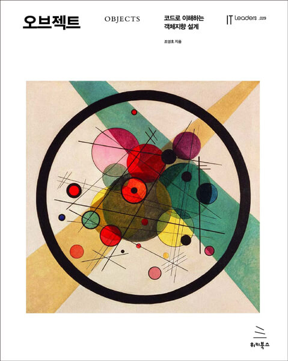

# TicketSellingApplication

조영호의 『오브젝트』를 읽고, 1장의 티켓 판매 예제를 Spring MVC 서버로 직접 구현하며 객체지향 설계를 연습하는 개인 프로젝트입니다.

<a href="https://wikibook.co.kr/object/"></a>

## 학습 목표

초대장을 가진 관객은 무료로, 일반 관객은 요금을 내고 입장합니다. 이 두 장면을 출발점으로 삼아, 판매 절차를 어느 객체가 얼마나 알아야 하는지 코드와 테스트로 살펴봅니다.

- **책임과 캡슐화** · 관객은 자신의 초대장과 돈을 관리하고, 매표소는 보유한 티켓과 판매금을 관리하도록 책임을 나눕니다. 판매원이 관객의 가방을 직접 열지 않고도 티켓을 건넬 수 있는 협력을 설계합니다.
- **추상화와 다형성** · 요금 규칙이 달라질 때 무엇이 함께 바뀌는지 살펴봅니다. 관객 유형에 따라 분기하는 구현과, 같은 요청에 각 요금 정책이 응답하는 구현을 비교합니다.
- **행동 중심 테스트** · 관객이 티켓을 받았는지, 지불한 금액만큼 매표소 판매금이 늘었는지를 JUnit으로 검증합니다. 책임을 다른 객체로 옮긴 뒤에도 같은 시나리오가 통과하는지 확인합니다.

## 실행

JDK 21과 MySQL이 필요합니다. MySQL에 `ticket_selling` 데이터베이스를 만들고, 해당 데이터베이스에 접근할 수 있는 계정으로 실행합니다.

```bash
export DB_USERNAME='사용할_MySQL_계정'
export DB_PASSWORD='해당_계정의_비밀번호'
./gradlew bootRun
```

기본 접속 주소는 `jdbc:mysql://localhost:3306/ticket_selling`입니다. 다른 주소를 쓰려면 `DB_URL`을 설정하세요.

## 테스트

```bash
./gradlew test
```

테스트는 메모리 H2를 사용하므로 MySQL 설치나 계정 설정 없이 실행할 수 있습니다.
